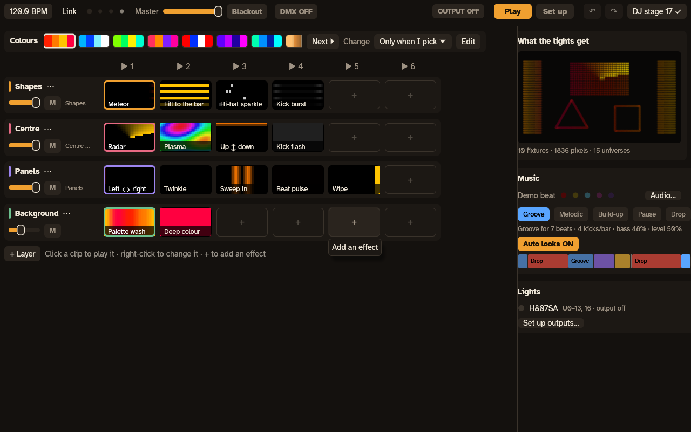
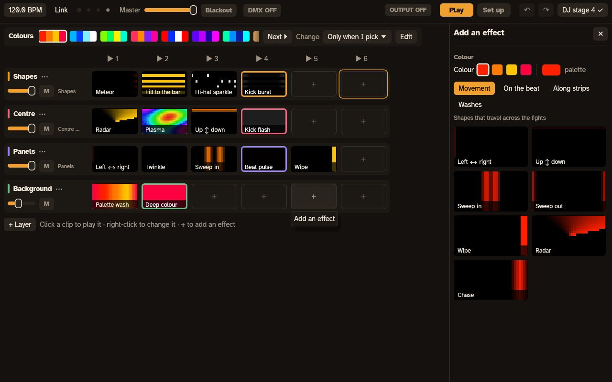
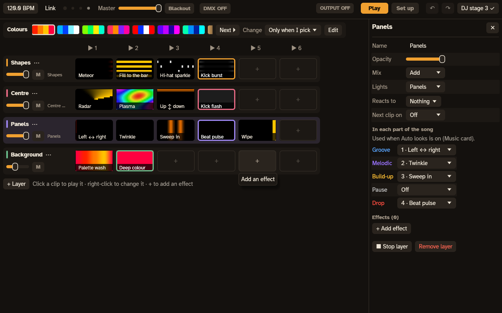
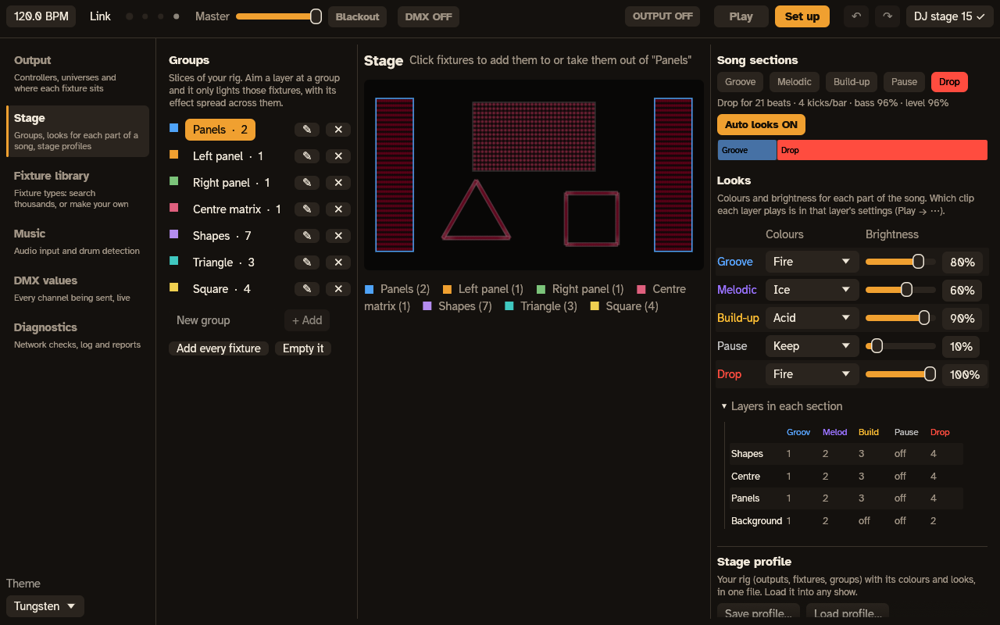
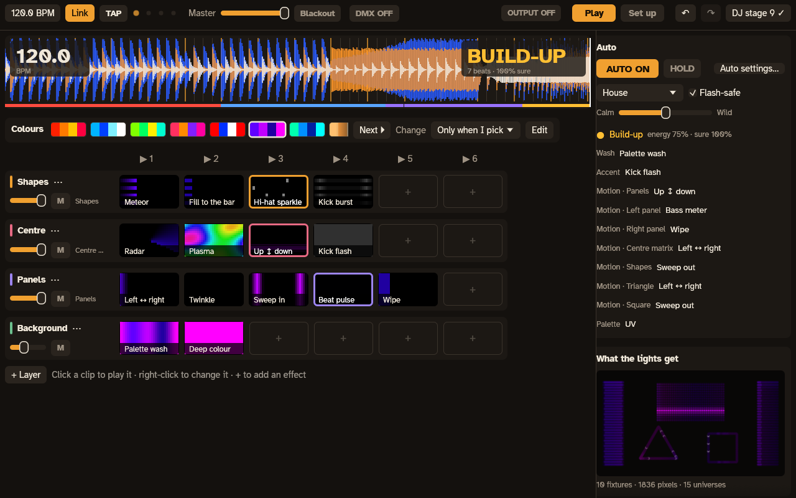
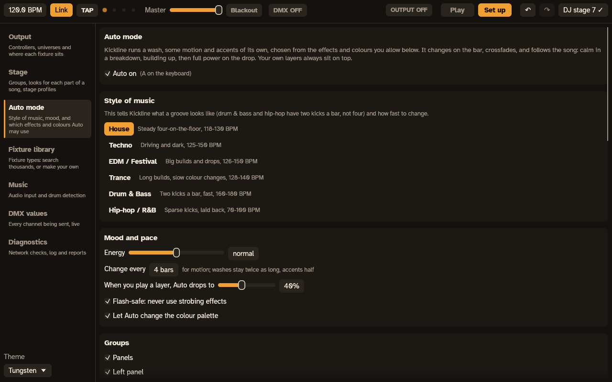
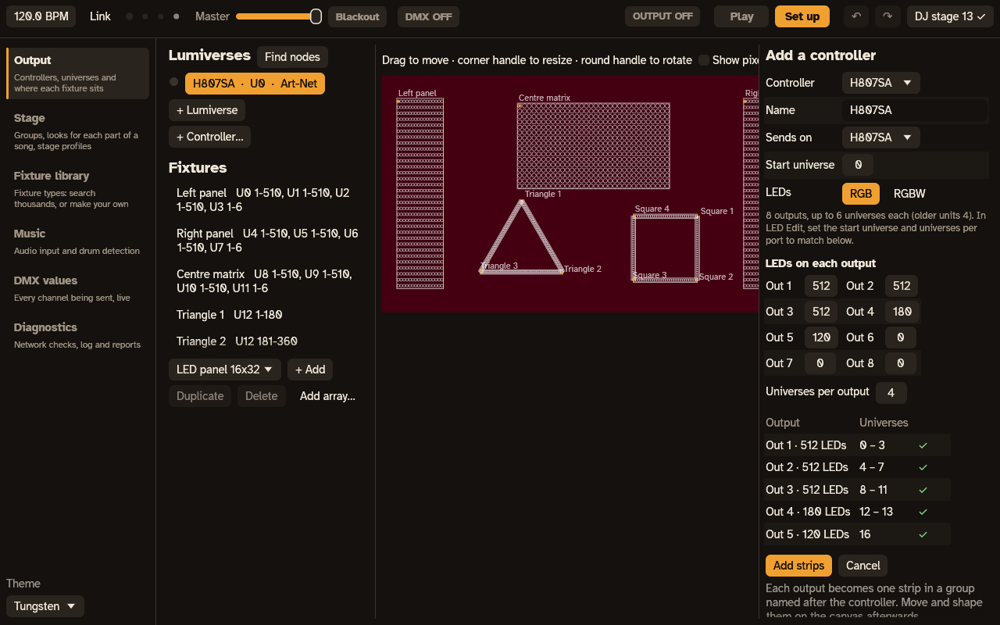
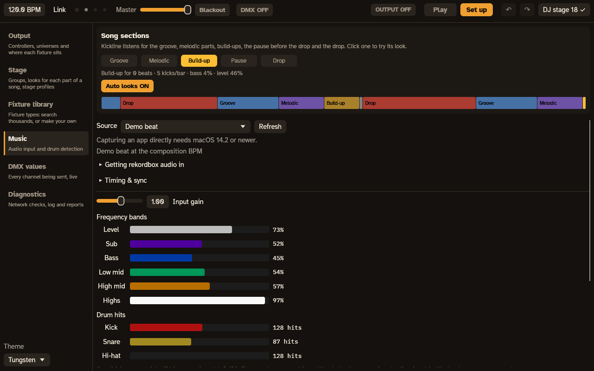

<p align="center">
  
</p>

<p align="center">
  <a href="https://github.com/powcomnsw/kickline/releases/latest"></a>
  <a href="https://github.com/powcomnsw/kickline/actions/workflows/macos.yml"></a>
  
  
  
</p>

<p align="center">
  <b><a href="https://github.com/powcomnsw/kickline/releases/latest">Download for Mac</a></b>
  &nbsp;·&nbsp; <a href="#quick-start">Quick start</a>
  &nbsp;·&nbsp; <a href="#features">Features</a>
  &nbsp;·&nbsp; <a href="#saving-your-show">Saving</a>
  &nbsp;·&nbsp; <a href="ROADMAP.md">Roadmap</a>
  &nbsp;·&nbsp; <a href="#reporting-problems">Report a problem</a>
</p>

---

Kickline is a free, open-source alternative to Resolume's lighting side, made for
DJs who run their own LEDs. Clips on layers are mixed into a canvas, the canvas is
mapped onto your fixtures and pixel strips, and it all goes out over Art-Net or
sACN. It listens to the music itself and splits it into **bass, kick, snare,
hi-hats and mids**, so each part of the track can drive a different part of the
rig.

> **New name.** Kickline used to be called Lumen. From 0.7.0 the app carries the new
> name and icon, and moves your Lumen projects and settings across by itself. macOS
> asks for its permissions (microphone, Local Network, audio recording) once more.

<p align="center">
  
</p>

## Features

<table>
<tr>
<td width="50%" valign="top">
<h3>Hears the music the way you do</h3>
<p>Not an FFT spectrum. A filter bank splits the sound into five bands and picks out <b>kick, snare and hi-hat</b> as separate triggers, about 13 ms after they happen. Route any of them to any layer: opacity follows the bass, the next clip fires on every snare, a white flash on each kick.</p>
</td>
<td width="50%" valign="top">
<h3>Built for rekordbox</h3>
<p>On macOS 14.2+ Kickline captures rekordbox's output <b>directly</b>, so no BlackHole and no extra delay. <b>Ableton Link</b> keeps it locked to rekordbox's tempo and beat, with Beat and Bar triggers fired slightly early to cancel out the network's delay.</p>
</td>
</tr>
<tr>
<td valign="top">
<h3>Pixel mapping that doesn't fight you</h3>
<p>Drag, resize and rotate fixtures straight onto the canvas. <b>Add array</b> lays out eight zig-zag strips, each on its own universe, in one go, and skips universes another node already uses. Snake wiring, reverse, RGBW white modes and automatic universe spill are all built in.</p>
</td>
<td valign="top">
<h3>Colour palettes</h3>
<p>Four colours that clips follow instead of fixed colours. Pick a new palette and the whole show recolours with a crossfade, or let it change every few bars, on the kick or on the snare. Eight palettes to start from, all editable.</p>
</td>
</tr>
<tr>
<td valign="top">
<h3>Knows where you are in the track</h3>
<p>Kickline listens for the <b>groove, melodic parts, build-ups, the pause before the drop and the drop</b>. Give each one a look (which clip every layer plays, the colours, the brightness) and turn on <b>Auto looks</b>: the lights change on the beat when the song does.</p>
</td>
<td valign="top">
<h3>Groups and your controller</h3>
<p>Put fixtures in <b>groups</b> (left panel, centre matrix, triangle…) and aim any layer at one: a sweep runs across just that group. Tell it your <b>controller</b> (H807SA and others) and how many LEDs are on each output, and it sets the universes up the way the controller counts.</p>
</td>
</tr>
<tr>
<td valign="top">
<h3>Auto mode: a lighting director</h3>
<p>Press <b>AUTO</b> (or <b>A</b>) and Kickline runs a wash, motion for each group and accents on the drums by itself: calm in a breakdown, rising through a build-up, everything on the drop. Tell it the style of music (house, techno, EDM, trance, drum &amp; bass, hip-hop), choose which effects and colours it may use, and it changes on the bar and crossfades. It steps back while you play your own layers, and <b>HOLD</b> (<b>H</b>) freezes the look.</p>
</td>
<td valign="top">
<h3>See the music</h3>
<p>A waveform strip across the top of Play shows the last 16 bars (bass in blue, mids in orange, highs in white) with the beat and bar lines and the song section underneath, next to big tempo and section readouts you can read from across the booth. <b>TAP</b> sets the tempo when you are not on Link.</p>
</td>
</tr>
<tr>
<td valign="top">
<h3>1,781 fixtures built in</h3>
<p>The full QLC+ fixture library, searchable, with every channel explained. Missing one? Drop a <code>.qxf</code> from the Open Fixture Library onto the window.</p>
</td>
<td valign="top">
<h3>Safe for live shows</h3>
<p>DMX runs on its own high-priority thread at a fixed rate, even when the window is hidden. <b>Find nodes</b> lists every Art-Net node and sets a lumiverse up in one click, and a dot per lumiverse turns red if a node stops answering mid-set. Pin each lumiverse to a network port: pull the adapter out, plug it back in, and output <b>resumes by itself</b>.</p>
</td>
</tr>
</table>

### See it

| | |
|---|---|
|  |  |
| **Play**: layers aimed at groups, what the lights get, the song section and the song so far | **Effect browser**: live tiles by kind, colour picked on its own |
|  |  |
| **Layer settings**: which group it lights, and its clip in each part of the song | **Set up → Stage**: groups, looks per section, stage profiles |
|  |  |
| **Auto mode**: the waveform strip, section and what Auto is showing | **Set up → Auto**: style of music, mood, and what Auto may use |
|  |  |
| **Add a controller**: an H807SA with LEDs per output, addressed for you | **Set up → Music**: the sections Kickline heard in the demo track |

## Quick start

1. **Install.** Download the `.dmg` from [Releases](https://github.com/powcomnsw/kickline/releases/latest),
   drag the app into Applications, then right-click it and choose **Open** the first time
   (it isn't signed by Apple yet; see [first launch](packaging/macos/INSTALL.txt)).
2. **Setup guide.** It opens the first time: it finds your controller, asks what
   lights you have (strips, panels or anything from the library), then lets you
   **test each light** for colour order and wiring direction. About five minutes.
3. **Sound.** In **Set up → Music**, click **Use rekordbox (direct)**. With no music
   playing, **Demo beat** works too (it plays a little track with a build-up and a drop).
4. **Play.** Click clips and palettes; **+** in an empty slot opens the effect browser,
   **⋯** on a layer opens its settings. Your show **saves by itself**, and **⌘Z** undoes anything.

Two screens: **Play** for the show, **Set up** for outputs, the stage (groups,
looks, stage profiles), the fixture library, music, DMX values and diagnostics.
To try everything at once: **Set up → Stage → Start a show from the example stage**.

## Saving your show

Everything is one **show file**: the clips on every layer, palettes, your
lumiverses (IP, universe, network port), every fixture and where it sits on the
canvas, fixture types, and the audio routing.

- **It saves by itself**, two seconds after any change and again when you quit.
  The show name at the top right shows **✓** when everything is saved, **•**
  while saving and **⚠** if saving failed (click it to see why).
- **Next week, just open Kickline.** It reopens the show you had open last, and
  shows your **recent shows** for a few seconds so you can switch with one click.
  They're also under **Open recent** in the show menu.
- **Backups:** every few minutes Kickline keeps a copy of the previous version,
  the last 10 per show, in `~/Documents/Kickline/Backups`. **Show backups** in the
  show menu opens the folder. A show that can't be read is never overwritten: it's
  renamed "… (couldn't open).json" and kept.
- **The show menu** (click the show name, top right):
  - **New show**: a fresh show with the demo clips and an empty patch, then the setup guide.
  - **Open…**: pick another show file.
  - **Save as…**: save a copy under a new name (e.g. one per venue) and keep working in the copy.
  - **Save now** (⌘S).
- **Undo / redo:** ⌘Z and ⌘⇧Z, or the ↶ ↷ buttons. Moving a fixture or deleting
  a clip can be undone; launching clips during a set never fills the undo list.

Shows live in `~/Documents/Kickline` as `.json` files, so they're easy to back
up, copy to another Mac, or send with a problem report. A show saved by an older
version opens in a newer one.

<details>
<summary><b>Other ways to get rekordbox audio in</b></summary>

- **macOS 14.2+:** Audio › **Use rekordbox (direct)**. No BlackHole needed.
- **Older macOS:** set rekordbox's master output to [BlackHole](https://existential.audio/blackhole/) (free) or Loopback and pick it as the input.
- **Windows:** pick the device rekordbox plays through, listed as "(loopback)".
- **Any computer:** cable the controller's booth or master out into an audio interface.

</details>

<details>
<summary><b>Checking your hardware first</b></summary>

Before adding fixtures, select a lumiverse in Advanced Output and click
**Sweep universes**. Kickline lights every channel of one universe at a time
(a short chase across each universe, 1.5 s each, or step with ◀ ▶) and shows which universe is on,
with its Art-Net Net:Sub-Net:Universe. Whatever lights up is listening to that
universe. If it lights one step late, your controller counts from 1. Moving heads
and strobes will move or flash during the sweep.

**Find nodes** lists every Art-Net controller that answers, and the status bar
shows **OUTPUT LIVE** / **OUTPUT DEAD** with the universes going out, so a dropped
cable shows up straight away, not mid-set.

</details>

<details>
<summary><b>Adding your fixtures</b></summary>

Fixture Editor › **Library**: search by brand, model, type or channel count:
"16 channel moving head", "par 7ch", "pixel bar", "chauvet slimpar". Each result
shows its type, the channel count of every mode and a coloured pinout (dimmer,
RGB, pan/tilt, gobo, strobe…); hover it for the breakdown. Pick the mode your
fixture is set to, then **Add and place in Advanced Output**.

Select a fixture in Advanced Output to see its **live channel values** as they're
sent, and **Test this light** to check colour order and wiring.

Not in the list? Download it from [open-fixture-library.org](https://open-fixture-library.org)
as a **QLC+ fixture** (`.qxf`) and drag the file onto the window. It's copied to
`~/Documents/Kickline/Fixtures`. Fixtures from an installed QLC+ are picked up too.

To change a fixture type later, select a fixture and click **Edit type**.

</details>

<details>
<summary><b>Splitting the music across effects</b></summary>

Each layer can react to a different part of the track:
- **Opacity follows** a band (e.g. a layer only shows when the high mids are busy).
- **Next clip on** Kick, Snare or Hi-hat steps through the layer's clips on each hit.
- **Audio flash** clips flash a colour on a band (white on kick, blue on hats).
- **Audio brightness / Audio hue** effects change any clip with the music.

The demo project shows one of each. The Audio window lists the current routing.

</details>

<details>
<summary><b>Colour palettes</b></summary>

The **Palette** strip above the clips holds four colours. Right-click a clip and
pick a palette swatch instead of a fixed colour, and it follows the palette.
Click another palette to recolour the whole show, or set **Change on** to Bar
(every 4 bars, say) for automatic changes. **Fade** sets the crossfade in beats.

</details>

<details>
<summary><b>Networking for live shows</b></summary>

Set each lumiverse's **Network port** to the adapter your node is on (e.g. a USB
Ethernet adapter). Kickline sends only through that port, and if it disappears it
keeps trying and resumes by itself when it's back. Diagnostics shows the
state of each port and how many times output recovered.

</details>

<details>
<summary><b>Performing: faders, drops, scenes and controllers</b></summary>

The **state line** at the top of the Play side says in words what is wrong
(output off, no music, a universe failing) or that the show is running.
**Mix** has Left, Centre and Right faders (they dim the lights whose group has
that role in Set up → Stage), an **A ↔ B** crossfader (give each layer a Deck
in its settings) and **Hold to build, release to drop**: hold it (or Space) and
the lights build; let go and the drop lands. **Scenes** at the bottom of the
clip grid are the looks Auto knows, with a colour taken from the look; click one
to play it. **Set so far** is a coloured timeline of what Auto played, with
drops marked; hover for the look and colours.

Right-click a clip for **speed** (¼× to 4×), **loop or one-shot** and fade in
and out. Set up → Stage can show a **photo of your rig** behind the fixtures
(and straighten it by its four corners) to place things against the real thing.

**Set up → Controllers** takes a MIDI controller (pick it, press Learn next to
a control, move a knob or hit a pad) and OSC (listen on a port; the addresses
`/kickline/master`, `/left`, `/centre`, `/right`, `/crossfade`, `/blackout`,
`/drop`, `/tap`, `/auto` and `/column/1…` work with no setup, and Kickline can
send its fader positions back to a TouchOSC-style app). Bindings are saved with
the show.

</details>

## Reporting problems

Open **Diagnostics**. It checks everything Kickline depends on and explains each
problem in plain language (e.g. *"Host unreachable: allow Kickline under Local
Network"*). Type what went wrong, click **Export report**, and send the
`.json` file it saves to your Desktop. It holds the checks, the event log, any
crash reports and (if you choose) your project. Nothing is uploaded.

## What's done

| Area | |
|---|---|
| Getting started | Setup guide (controller → lights → test → play), "Test this light" for colour order and wiring, plain-language hover help for every lighting term |
| Saving | Autosave, reopens your last show, recent shows, rolling backups, New / Open / Save as, undo and redo (⌘Z / ⌘⇧Z) that never stops what's playing |
| Look | Three dark themes (Tungsten, Gel, Stage) for dark venues, Atkinson Hyperlegible font, live clip thumbnails, a colour per layer |
| Composition | Layers × clip grid, column triggers, opacity / blend / bypass / effects per layer, master, BPM clock, right-click clip editing |
| Generators | Solid, Rainbow, Strobe, Chase, Plasma, Audio flash, Bands, Palette wash |
| Strip effects | Run along every strip on its own, at any angle: Meteor (and bounce), Fill, Kick burst, Segments, Sparkle, Meter, Dashes, Alternate. Reverse, from-the-middle and a ripple across strips. Shown live in the preview |
| Effects | Brightness, Hue shift, Invert, Pulse, Audio brightness, Audio hue |
| Colour palettes | Clips use palette colour 1–4 or a fixed colour; 8 palettes to start, editable; change on Bar / Beat / Kick / Snare / Hi-hat every N, with a crossfade |
| Output health | Status bar: OUTPUT LIVE / PARTLY FAILING / DEAD (blinks, DMX button turns red), universes going out with Art-Net net/sub-net, universe count and rate. Universe sweep with no fixtures needed. Live channel values for the selected fixture |
| Smooth output | ArtSync so every universe changes on the same frame, per-controller refresh cap for pixel controllers that glitch when fed too fast |
| Art-Net nodes | Find nodes (ArtPoll) with one-click setup; live status per lumiverse, wrong-universe warnings, alert when a node drops out |
| Advanced Output | Art-Net / sACN lumiverses with their own universe, IP and network port; drag / resize / rotate fixtures; snake and reverse wiring; universe spill; overlap warnings; array tool; RGBW white modes |
| Fixtures | 1,781 built-in (QLC+), search by type and channel count, pinout preview per mode, "Kickline can drive" filter, `.qxf` import, pixel-grid editor, colour order presets |
| Audio | Live input or loopback, 5 bands + level, kick / snare / hi-hat detection that works at any volume and through loud, sidechained masters, sensitivity per drum with a live meter, per-layer routing |
| rekordbox | Direct capture on macOS 14.2+, Ableton Link tempo and beat sync |
| Timing | Engine on its own thread at a fixed DMX rate (44 Hz default); hits sent about 1 ms after detection |
| Diagnostics | System, audio, network, Art-Net node discovery, project and performance checks; crash capture; exportable report |

Coming next: cue lists, MIDI controllers, moving heads, and video clips. See the
[roadmap](ROADMAP.md).

## For developers

```sh
cargo run --release -p lumen-app
cargo test --workspace
```

Linux needs ALSA headers (`sudo apt install libasound2-dev`).

**Mac app:** on a Mac with Xcode Command Line Tools and Rust:

```sh
./scripts/build-macos.sh          # universal app + dist/<name>-<version>.dmg
./scripts/build-macos.sh --native # this Mac's architecture only, faster
```

Every push to `main` that changes code builds the `.dmg` on GitHub and publishes
it as a release named after the version in `Cargo.toml`.

```
crates/lumen-core      frames, generators, effects, palettes, composition (no I/O)
crates/lumen-fixtures  Advanced Output model: lumiverses, fixture types, arrays, canvas → DMX
crates/lumen-output    Art-Net and sACN packets, network ports, node discovery
crates/lumen-audio     filter bank, band levels, kick/snare/hat detection, audio input
crates/lumen-app       the app (egui + wgpu)
```

The engine crates don't depend on the GUI, so a headless runner, a web UI or a
plugin host could reuse them.

## Licence

Kickline's own code is MIT OR Apache-2.0. Builds with Ableton Link (the default
`link` feature) include Ableton's GPL-2.0-or-later Link library, so those
binaries are distributed under the GPL. Build with `--no-default-features`
for a Link-free MIT/Apache build.

Fonts: Atkinson Hyperlegible and IBM Plex Mono, SIL Open Font License 1.1
(`crates/lumen-app/assets/fonts`). Built-in fixture definitions come from the
[QLC+](https://github.com/mcallegari/qlcplus) project (Apache-2.0); see
`crates/lumen-fixtures/assets/QLCPLUS-LICENSE.txt`.
