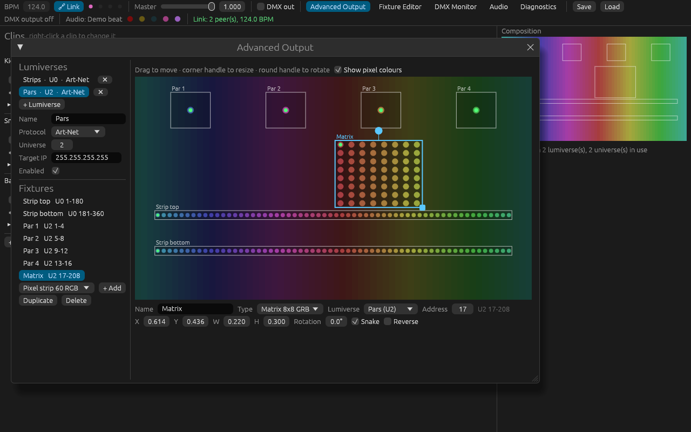
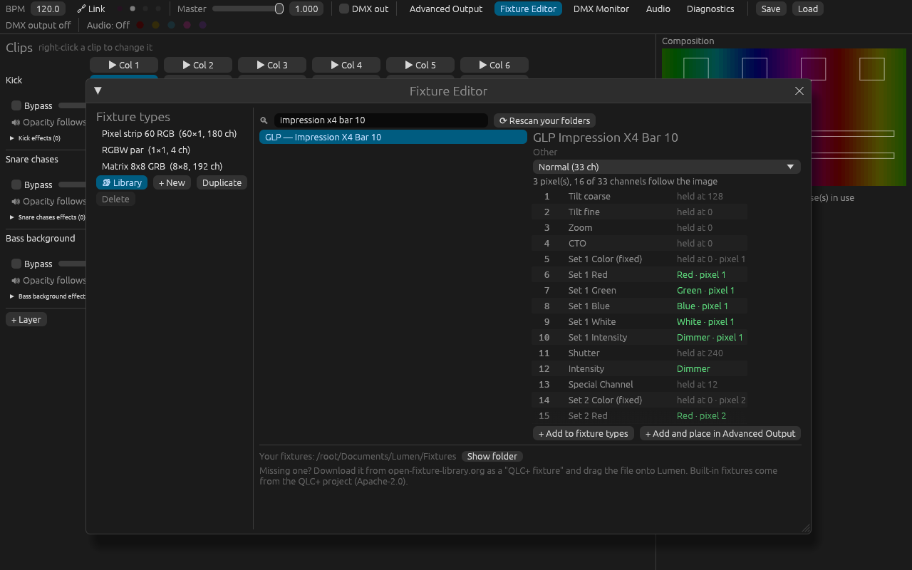
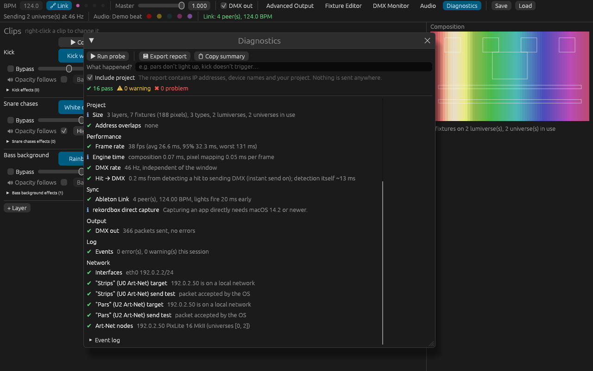
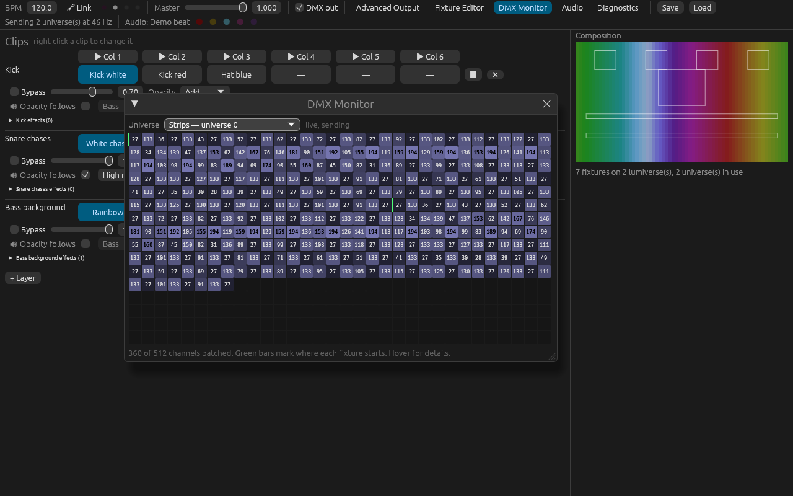

# Lumen

An open-source, Resolume-style VJ and lighting controller written in Rust.
Clips on layers are composited into a canvas, the canvas is pixel-mapped onto
patched DMX fixtures, and the result goes out over Art-Net or sACN.

**Mac download:** [latest release](https://github.com/powcomnsw/lumen/releases/latest)
(see [first launch](packaging/macos/INSTALL.txt)).


| | |
|---|---|
|  |  |
| **Advanced Output** — lumiverses, fixtures placed on the composition, live pixel colours | **Fixture library** — 1,781 built-in fixtures (QLC+), shows what each channel does |
|  |  |
| **Audio** — bands, kick/snare/hat, Ableton Link, timing | **Diagnostics** — one-click probe and exportable report |
|  | |
| **DMX Monitor** — live values of every channel | |

## Status: v0.5

| Area | Done |
|---|---|
| Composition | Layers × clip grid, column triggers, opacity / blend / bypass / effects per layer, master, BPM clock, right-click clip editing |
| Generators | Solid, Rainbow, Strobe, Chase, Plasma, Audio flash, Bands |
| Effects | Brightness, Hue shift, Invert, Pulse, Audio brightness, Audio hue |
| Advanced Output | Lumiverses (Art-Net / sACN, own universe and IP each), fixtures dragged, resized and rotated on the composition, snake / reverse wiring, auto universe spill, overlap warnings |
| Fixture Editor | Pixel grids (columns × rows), colour order presets, per-pixel and header channels |
| Fixture library | 1,781 fixtures built in (QLC+ library), search, pick a mode, add and place in one click; import any QLC+ `.qxf` (e.g. from the Open Fixture Library) by dragging it onto the window. RGB/W/A, CMY, UV, dimmers, 16-bit fine channels and multi-pixel heads are driven; shutters are held open, pan/tilt centred |
| DMX Monitor | Live 512-channel view per universe with fixture boundaries |
| Audio | Live input or loopback, 5 frequency bands + level, kick / snare / hi-hat detection (filter bank, no FFT), per-layer routing |
| Timing | Engine on its own thread at a fixed DMX rate (default 44 Hz, keeps running when the window is hidden); hits sent instantly (~1 ms after detection); kick detection ~13 ms (Stable/Balanced/Fast) |
| rekordbox | Direct capture of rekordbox's output on macOS 14.2+ (Core Audio process tap, no BlackHole); Ableton Link tempo/beat sync with Beat and Bar triggers and fire-early compensation |
| Diagnostics | One-click probe (system, audio, network, Art-Net node discovery, project, performance), event log, crash capture, exportable JSON report |
| macOS | `.app` + `.dmg` build script (universal), mic and local-network permissions, GitHub Actions workflow |

## Run

```sh
cargo run --release -p lumen-app
cargo test --workspace
```

Linux needs ALSA headers to build (`sudo apt install libasound2-dev`).

Open **Advanced Output** to place fixtures and set each lumiverse's IP, then tick
**DMX out**. Open **Audio** to choose the input; **Demo beat** works with no music.

### Getting rekordbox audio in

Lumen analyses the audio itself, so it needs to hear what rekordbox plays:
- **macOS 14.2+:** Audio › **Use rekordbox (direct)**. No BlackHole needed.
- **Windows:** pick the device rekordbox outputs to; it's listed as "(loopback)".
- **macOS:** set rekordbox's master output to [BlackHole](https://existential.audio/blackhole/) (free) or Loopback and select it as the input.
- **Any OS:** cable the controller's booth or master out into an audio interface input.

### Adding your fixtures

Fixture Editor › **📚 Library**, search for the brand or model, pick the mode
your fixture is set to, then **Add and place in Advanced Output**. The list
shows what Lumen does with every channel.

Not in the list? Download it from [open-fixture-library.org](https://open-fixture-library.org)
as a **QLC+ fixture** (`.qxf`) and drag the file onto Lumen. It's copied to
`~/Documents/Lumen/Fixtures`. Fixtures from an installed QLC+ are picked up too.

### Splitting the music across effects

Each layer can react to a different part of the track:
- **Opacity follows** a band (e.g. a layer only shows when the high mids are busy).
- **Next clip on** Kick, Snare or Hi-hat steps through the layer's clips on each hit.
- **Audio flash** clips flash a colour on a band (white on kick, blue on hats).
- **Audio brightness / Audio hue** effects modulate any clip.

The demo project shows one of each. The Audio window lists the current routing.

## Reporting problems

Open **Diagnostics**. It probes everything Lumen depends on and explains each
problem in plain language (e.g. *"Host unreachable: allow Lumen under Local
Network"*). Type what went wrong, click **Export report**, and send the
`lumen-report-*.json` file from your Desktop. It contains the checks, the
event log, any crash reports and (optionally) your project. Nothing is uploaded.

## Building the Mac app

On a Mac with Xcode Command Line Tools and Rust installed:

```sh
./scripts/build-macos.sh          # universal Lumen.app + dist/Lumen-<version>.dmg
./scripts/build-macos.sh --native # just this Mac's architecture, faster
```

Or push the repo to GitHub and run the **macOS build** workflow; the `.dmg` is
attached to the run. See `packaging/macos/INSTALL.txt` for first-launch steps.

## Layout

```
crates/lumen-core      frames, generators, effects, blend, composition (no I/O)
crates/lumen-fixtures  Advanced Output model: lumiverses, fixture types, placement, canvas -> DMX
crates/lumen-output    Art-Net + sACN packet builders and UDP sender
crates/lumen-audio     filter bank, band envelopes, kick/snare/hat detection, cpal input
crates/lumen-app       egui front end
```

The engine crates have no GUI dependency, so a headless/CLI runner, a web UI
or a plugin host can reuse them.

## Roadmap

See [ROADMAP.md](ROADMAP.md).

## Licence

Lumen's own code is MIT OR Apache-2.0. Builds with Ableton Link (the default
`link` feature) include Ableton's GPL-2.0-or-later Link library, so those
binaries are distributed under the GPL. Build with `--no-default-features`
for a Link-free MIT/Apache build.

The built-in fixture definitions come from the [QLC+](https://github.com/mcallegari/qlcplus)
project (Apache-2.0); see `crates/lumen-fixtures/assets/QLCPLUS-LICENSE.txt`.
Refresh them with `scripts/pack-fixtures.py`.
